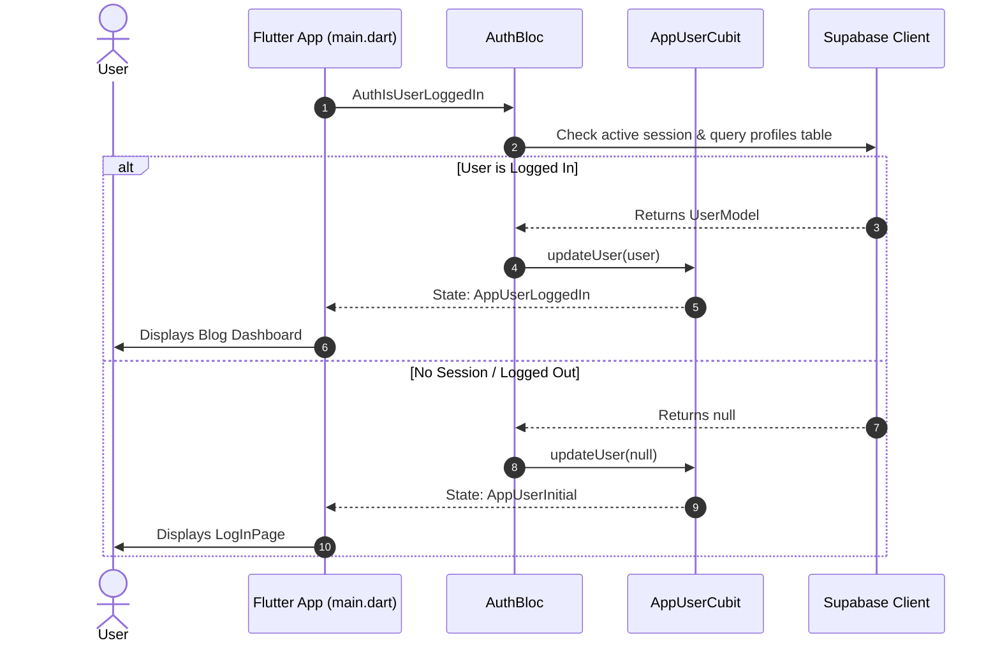

# 📝 Blog App (Flutter & Supabase)

[](https://flutter.dev)
[](https://dart.dev)
[](https://supabase.com)
[](https://bloclibrary.dev)
[](https://blog.cleancoder.com/uncle-bob/2012/08/13/the-clean-architecture.html)
[](LICENSE)

A modern, scalable, and responsive **Blogging Application** built with **Flutter** and powered by **Supabase**. This project strictly implements **Uncle Bob's Clean Architecture**, the **BLoC (Business Logic Component)** pattern for state management, functional error handling using **fpdart**, and dependency injection via **GetIt**.

---

## 📌 Table of Contents

- [Overview](#-overview)
- [✨ Current Progress & Features Implemented](#-current-progress--features-implemented)
- [🏗️ Architectural Pattern](#️-architectural-pattern)
- [📂 Project Structure](#-project-structure)
- [🛠️ Tech Stack & Libraries](#️-tech-stack--libraries)
- [🚀 Getting Started](#-getting-started)
  - [Prerequisites](#prerequisites)
  - [Supabase Setup](#supabase-setup)
  - [Configuration](#configuration)
  - [Run the App](#run-the-app)
- [🧭 Application Flow](#-application-flow)
- [🗺️ Roadmap](#️-roadmap)
- [🤝 Contributing](#-contributing)
- [📄 License](#-license)

---

## 📖 Overview

The goal of this project is to build a full-featured, production-ready blogging platform. Up to this point, the entire **core foundational architecture** and complete **Authentication & User Management feature** have been developed from scratch following industry best practices.

---

## ✨ Current Progress & Features Implemented

Here is what has been built and tested up to this point:

### 🔐 1. Authentication Feature (Complete)
- **User Registration (Sign Up)**:
  - Form validation with customized email, password, and full name fields.
  - User creation through Supabase Auth, storing metadata (`name`).
  - Interactive gradient action buttons with automated loading state indicator (`Loader`).
  - Graceful error messaging with customized SnackBars.
- **User Authentication (Sign In / Login)**:
  - Secure login using email and password against Supabase Auth.
  - Seamless input handling with automatic keyboard management.
  - Routing to the main feed / blog landing view upon successful credentials validation.
- **Persistent Session & Current User Resolution**:
  - Automatically checks for existing active sessions on app launch (`AuthIsUserLoggedIn`).
  - Fetches user profile data from the PostgreSQL `profiles` table in Supabase.
  - Decoupled session broadcasting through `AppUserCubit` to synchronize authentication state globally.
  - Immediate auto-navigation: logged-in users bypass the login screen directly to the main screen.

### 🏛️ 2. Clean Architecture & Code Organization
- Completely decoupled into **Domain**, **Data**, and **Presentation** layers:
  - **Domain Layer**: Pure Dart, containing business logic entities, use cases (`UserSignUp`, `UserLogIn`, `CurrentUser`), and abstract repository interfaces (`AuthRepository`).
  - **Data Layer**: Supabase remote data source implementation (`AuthRemoteDataSourceImpl`), data models with JSON serialization (`UserModel`), and repository implementation (`AuthRepositoryImpl`).
  - **Presentation Layer**: UI pages (`SignUpPage`, `LogInPage`, `BlogPage`), reusable widgets (`AuthField`, `AuthGradientButton`), and reactive BLoC state management (`AuthBloc`).

### 🛡️ 3. Robust Functional Error Handling
- Leverages **`fpdart`** to return `Either<Failure, Success>` across repositories and use cases.
- Replaces runtime exception crashes with typed, predictable error pipelines.
- Standardized `Failure` and `ServerExceptions` models across the application.

### 💉 4. Dependency Injection & Inversion of Control
- Centralized Service Locator using **`get_it`** in `init_dependencies.dart`.
- Clean lifecycle management:
  - Singletons for clients (`SupabaseClient`) and global state cubits (`AppUserCubit`).
  - Factories for use cases, repositories, and data sources for memory efficiency.

### 🎨 5. Modern UI & Theming
- Sleek **Dark Theme** system with a unified color palette (`AppPallete`).
- Reusable custom input decoration styles with focus-state gradient outlines.
- Eye-catching radial/linear gradient button component (`AuthGradientButton`).
- Centralized named route management (`AppRoutes` and `RouteName`).

---

## 🏗️ Architectural Pattern

The application enforces **Clean Architecture** to ensure testability, maintainability, and loose coupling:

```
                      ┌────────────────────────────────┐
                      │       Presentation Layer       │
                      │  (Pages, Widgets, BLoC, Cubit) │
                      └──────────────┬─────────────────┘
                                     │ depends on
                                     ▼
                      ┌────────────────────────────────┐
                      │          Domain Layer          │
                      │   (UseCases, Entities, Repos)  │
                      └──────────────▲─────────────────┘
                                     │ implemented by
                                     │
                      ┌──────────────┴─────────────────┐
                      │           Data Layer           │
                      │ (DataSources, Models, RepoImpl)│
                      └────────────────────────────────┘
                                     ▲
                                     │
                             Supabase Client / API
```

- **Entities & UseCases** have zero dependencies on Flutter or third-party SDKs.
- **Data Layer** handles external network requests and translates raw responses into Domain Entities.
- **Presentation Layer** listens to BLoC states and renders UI accordingly.

---

## 📂 Project Structure

```
lib/
├── core/
│   ├── common/
│   │   ├── cubits/
│   │   │   └── app_user/          # Global AppUserCubit & AppUserState
│   │   ├── entity/                # Shared domain entities (User)
│   │   └── widgets/               # Reusable UI widgets (Loader)
│   ├── error/
│   │   ├── exceptions.dart        # Custom server/cache exceptions
│   │   └── failures.dart          # Failure classes for Either returns
│   ├── route/
│   │   ├── app_routes.dart        # Route generator (onGenerateRoute)
│   │   └── route_name.dart        # Route name constants
│   ├── secrets/
│   │   └── app_secrets.dart       # Supabase URL and anon/public key
│   ├── theme/
│   │   ├── app_pallete.dart       # Centralized color definitions
│   │   └── app_theme.dart         # ThemeData configurations
│   ├── usecase/
│   │   └── usecase.dart           # Base UseCase<SuccessType, Params> contract
│   └── utils/
│       └── show_snackbar.dart     # SnackBar helper utility
├── features/
│   ├── auth/
│   │   ├── data/
│   │   │   ├── datasources/       # AuthRemoteDataSource (Supabase auth calls)
│   │   │   ├── model/             # UserModel with JSON parsing & copyWith
│   │   │   └── repository/        # AuthRepositoryImpl
│   │   ├── domain/
│   │   │   ├── repository/        # AuthRepository interface
│   │   │   └── usecases/          # UserSignUp, UserLogIn, CurrentUser
│   │   └── presentation/
│   │       ├── bloc/              # AuthBloc, AuthEvent, AuthState
│   │       ├── pages/             # SignUpPage, LogInPage
│   │       └── widgets/           # AuthField, AuthGradientButton
│   └── blog/
│       └── presentation/
│           └── pages/             # BlogPage (Initial dashboard view)
├── init_dependencies.dart         # GetIt dependency injection setup
└── main.dart                      # App entry point, MultiBlocProvider & Auth check
```

---

## 🛠️ Tech Stack & Libraries

| Package | Version | Purpose |
|---|---|---|
| **[flutter_bloc](https://pub.dev/packages/flutter_bloc)** | `^9.1.1` | Predictable state management following BLoC pattern |
| **[supabase_flutter](https://pub.dev/packages/supabase_flutter)** | `^2.18.3` | Backend integration (Authentication, Database, Realtime) |
| **[fpdart](https://pub.dev/packages/fpdart)** | `^1.2.0` | Functional programming utilities (`Either`, `Option`) |
| **[get_it](https://pub.dev/packages/get_it)** | `^9.3.0` | Inversion of Control (IoC) / Service Locator for DI |
| **[cupertino_icons](https://pub.dev/packages/cupertino_icons)** | `^1.0.8` | iOS style iconography |

---

## 🚀 Getting Started

### Prerequisites

Ensure you have the following installed on your machine:
- [Flutter SDK](https://docs.flutter.dev/get-started/install) (`>= 3.13.7`)
- [Dart SDK](https://dart.dev/get-dart)
- An active [Supabase](https://supabase.com/) account and project

### Supabase Setup

1. Create a new project in your **Supabase Dashboard**.
2. Run the following SQL query in the **Supabase SQL Editor** to create the `profiles` table:

```sql
-- Create a table for public user profiles
create table profiles (
  id uuid references auth.users not null primary key,
  updated_at timestamp with time zone,
  name text,
  email text
);

-- Enable Row Level Security (RLS)
alter table profiles enable row level security;

-- Create policies for profiles
create policy "Public profiles are viewable by everyone." on profiles
  for select using (true);

create policy "Users can insert their own profile." on profiles
  for insert with check (auth.uid() = id);

create policy "Users can update their own profile." on profiles
  for update using (auth.uid() = id);

-- Automatically create a profile entry when a new user signs up
create or replace function public.handle_new_user()
returns trigger as $$
begin
  insert into public.profiles (id, name, email)
  values (new.id, new.raw_user_meta_data->>'name', new.email);
  return new;
end;
$$ language plpgsql security definer;

create trigger on_auth_user_created
  after insert on auth.users
  for each row execute procedure public.handle_new_user();
```

### Configuration

1. Clone the repository:
   ```bash
   git clone https://github.com/pallab56/blog_app_complete.git
   cd blog_app_complete
   ```

2. Install dependencies:
   ```bash
   flutter pub get
   ```

3. Configure your API keys in `lib/core/secrets/app_secrets.dart`:
   ```dart
   class AppSecrets {
     static const supabaseUrl = 'YOUR_SUPABASE_PROJECT_URL';
     static const supabasePubKey = 'YOUR_SUPABASE_ANON_PUBLIC_KEY';
   }
   ```
   > ⚠️ **Note**: Never expose service role keys in client-side code. Only use the public `anon` key.

### Run the App

Start the development server on your connected emulator or device:
```bash
flutter run
```

---

## 🧭 Application Flow



---

## 🗺️ Roadmap

- [x] **Project initialization** & Clean Architecture layer scaffolding
- [x] **Theming & design system** (Dark mode, custom borders, gradient buttons)
- [x] **Dependency injection** setup using GetIt
- [x] **Supabase integration** for Authentication (Sign Up & Log In)
- [x] **Session persistence** & auto-login check via `AppUserCubit`
- [ ] **Blog Data Layer**:
  - Blog post model and JSON converters
  - Remote data source for creating and fetching blogs
  - Supabase Storage bucket integration for blog header images
- [ ] **Blog Domain Layer**:
  - Repository contracts & UseCases (`UploadBlog`, `GetAllBlogs`)
- [ ] **Blog Presentation Layer**:
  - Feed view with blog cards and reading time calculations
  - Add new blog screen with image picker and category tags
  - Blog details view with rich content formatting
- [ ] **Offline-first caching** (Local storage with Hive or SQLite)
- [ ] **User Profile & Logout** functionality

---

## 🤝 Contributing

Contributions, issues, and feature requests are welcome! Feel free to check the [issues page](https://github.com/pallab56/blog_app_complete/issues).

1. Fork the Project
2. Create your Feature Branch (`git checkout -b feature/AmazingFeature`)
3. Commit your Changes (`git commit -m 'Add some AmazingFeature'`)
4. Push to the Branch (`git push origin feature/AmazingFeature`)
5. Open a Pull Request

---

## 📄 License

This project is licensed under the MIT License - see the [LICENSE](LICENSE) file for details.

---

<p align="center">
  Built with ❤️ using <b>Flutter</b> and <b>Supabase</b>
</p>
