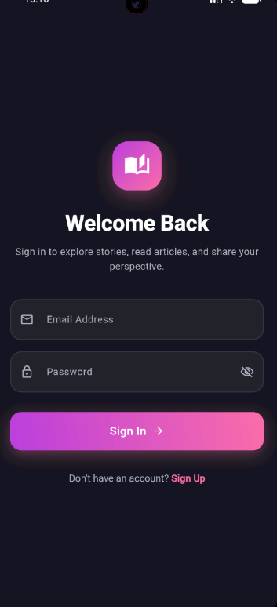
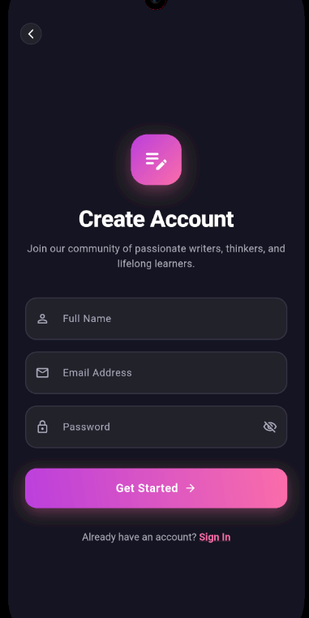
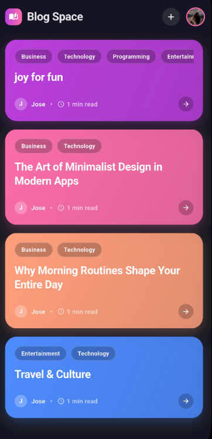
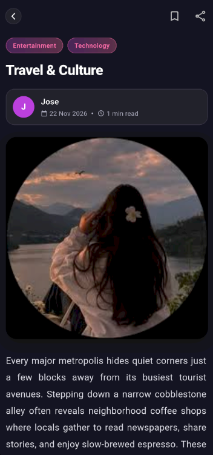
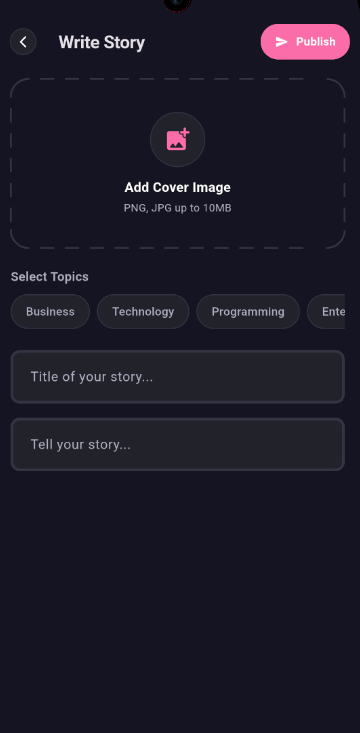
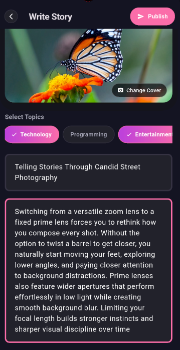
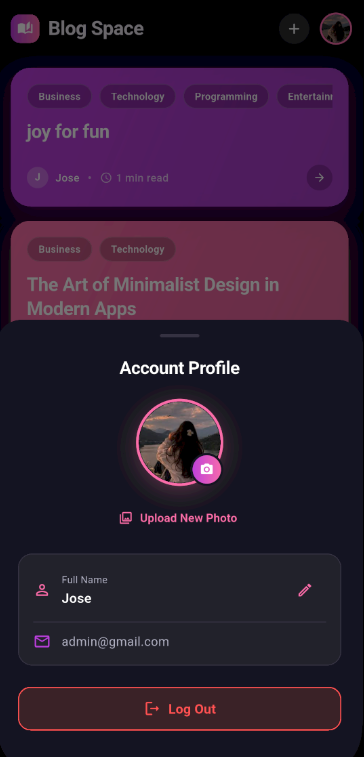
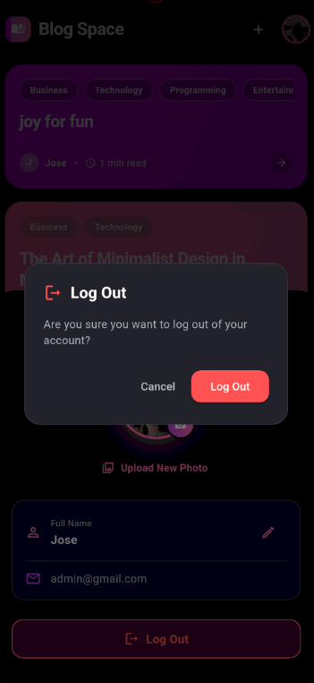

# 📝 Blog App (Flutter, Supabase & Clean Architecture)

[](https://flutter.dev)
[](https://dart.dev)
[](https://supabase.com)
[](https://pub.dev/packages/hive)
[](https://bloclibrary.dev)
[](https://blog.cleancoder.com/uncle-bob/2012/08/13/the-clean-architecture.html)
[](LICENSE)

A modern, offline-first **Blogging Application** built with **Flutter**, powered by **Supabase** (PostgreSQL + Auth + Storage) and cached locally with **Hive**. 

This project is built from the ground up following **Uncle Bob's Clean Architecture**, the **BLoC & Cubit** state management pattern, functional programming with **fpdart**, and dependency injection via **GetIt**.

---

## 📌 Table of Contents

- [Overview](#-overview)
- [📱 App Screenshots](#-app-screenshots)
- [✨ Key Features Implemented](#-key-features-implemented)
  - [1. Authentication & Profile Management](#1-authentication--profile-management)
  - [2. Blog & Editorial Experience](#2-blog--editorial-experience)
  - [3. Network Awareness & Offline-First Caching](#3-network-awareness--offline-first-caching)
  - [4. Architectural Foundations](#4-architectural-foundations)
- [🧠 What You Can Learn From This Project](#-what-you-can-learn-from-this-project)
- [🏗️ Architectural Pattern](#️-architectural-pattern)
- [📂 Project Directory Structure](#-project-directory-structure)
- [🛠️ Tech Stack & Dependencies](#️-tech-stack--dependencies)
- [🚀 Getting Started](#-getting-started)
  - [Prerequisites](#prerequisites)
  - [Supabase Setup & RLS Policies](#supabase-setup--rls-policies)
  - [Installation & Run](#installation--run)
- [📄 License](#-license)

---

## 📖 Overview

The goal of this application is to deliver a seamless, publication-quality reading and writing experience (inspired by platforms like *Medium* and *Substack*), while serving as a reference implementation for **scalable mobile architecture**:
- **Offline-First**: Users can continue reading their cached stories even with zero internet connectivity.
- **Strict Clean Architecture**: High testability, zero UI logic in data layers, and pure domain business rules.
- **Fail-Safe Security**: Database and storage buckets guarded by PostgreSQL **Row Level Security (RLS)**.

---

## 📱 App Screenshots

<details open>
<summary><b>📸 Click to toggle Screenshots Gallery</b></summary>
<br/>

### 🔐 Authentication & Onboarding
| Sign In Screen | Sign Up Screen |
| :---: | :---: |
|  |  |

### 📰 Story Feed & Reading Experience
| Blog Feed (Rotating Palette) | Editorial Story Viewer |
| :---: | :---: |
|  |  |

### ✍️ Story Creation & Publishing
| Create Story (Form) | Story with Cover & Topics |
| :---: | :---: |
|  |  |

### 👤 Profile & Account Management
| User Profile Modal | Log Out Confirmation |
| :---: | :---: |
|  |  |

</details>

---

## ✨ Key Features Implemented

### 1. Authentication & Profile Management
- **Editorial Sign In & Sign Up Screens**:
  - Branded editorial identity with custom iconography and typography.
  - Interactive password visibility toggle (`Icons.visibility` / `Icons.visibility_off`).
  - Strict form validation (email regex and password length constraints).
  - Responsive layout wrapped in bouncing scroll views to prevent keyboard overflows.
- **Persistent Authentication**:
  - Automatically checks for existing sessions on app launch (`AuthIsUserLoggedIn`).
  - Broadcasts active session to an app-wide `AppUserCubit` to synchronize authentication across all screens.
- **User Profile in AppBar**:
  - Shows user photo if uploaded, or generates uppercase initials with a gradient ring.
  - Tapping the avatar opens a modern **Account Profile Modal**.
- **Edit & Update Display Name**:
  - Inline name-editing dialog allowing users to set or update their public author name.
  - Syncs with both Supabase `profiles` table and `auth.users` metadata in real time.
- **Profile Picture Upload**:
  - Integrates `image_picker` to upload custom user avatars directly to Supabase Storage.
  - Uses unique timestamp identifiers to prevent caching and storage upload collisions.
- **Safe Log Out**:
  - Confirmation dialog preventing accidental logouts.
  - Signs out from Supabase, resets `AppUserCubit`, and clears the navigation route stack.

---

### 2. Blog & Editorial Experience
- **Interactive Story Feed**:
  - Pull-to-refresh (`RefreshIndicator`) for live blog updates.
  - Rotating harmonic card palette (`gradient1` through `gradient4`) for visual rhythm.
  - Elegant empty state with an illustrated badge and a *"Write First Story"* action.
- **Polished Blog Cards**:
  - Elevated cards with smooth `22px` rounded corners and colored soft drop shadows.
  - Translucent topic pill badges with frosted glass borders.
  - Author info avatar, calculated reading time (`calculatedReadingTime(content)`), and tap ripple animation.
- **Editorial Story Viewer**:
  - Medium/Substack-style reading layout with clean typography (`17px`, line-height `1.85`).
  - Author metadata bar with formatted date (`dateFormatByDMMMYYY`) and reading time badge.
  - Full-width hero image with progress indicator and broken-image fallback.
  - Top action bar featuring a reactive **Bookmark** toggle and **Share** button.
- **Create New Story Screen**:
  - Cover image picker with dotted upload box and *"Change Cover"* preview overlay.
  - Animated category selector (`Business`, `Technology`, `Programming`, `Entertainment`) with checkmark feedback.
  - Actionable validation alerts if cover image, topic, or content is missing.
  - Direct upload of blog image to Supabase Storage and database insertion into PostgreSQL `blogs` table.

---

### 3. Network Awareness & Offline-First Caching
- **Reactive Connectivity Checking**:
  - Abstracted `InternetConnectionChecker` powered by `internet_connection_checker_plus`.
  - Checks network state before executing network requests.
- **Local Caching with Hive**:
  - **Online Mode**: When connected, stories are fetched from Supabase Remote Data Source and automatically written to a local **Hive Box** (`blogsBox`).
  - **Offline Mode**: If internet is unavailable, `BlogRepositoryImpl` seamlessly intercepts the request and loads all previously cached stories from **Hive Local Data Source** with zero crashes.
  - **Fail-Safe Offline Auth**: When internet is offline, `AuthRepositoryImpl` resolves the user from the local Supabase session cache.

---

### 4. Architectural Foundations
- **Uncle Bob's Clean Architecture**:
  - **Domain Layer**: Independent Dart entities (`User`, `Blog`), use cases (`UserSignUp`, `UserLogIn`, `UserLogOut`, `CurrentUser`, `UploadProfileImage`, `UpdateUserName`, `UploadBlog`, `GetAllBlogs`), and abstract repository interfaces.
  - **Data Layer**: Concrete repository implementations, remote data sources (Supabase client), local data sources (Hive), and serializable models (`UserModel`, `BlogModel`).
  - **Presentation Layer**: UI pages, reusable widgets, and state management via `AuthBloc`, `BlogBloc`, and `AppUserCubit`.
  - **Core Layer**: Shared theme (`AppPallete`, `AppTheme`), errors (`Failure`, `ServerExceptions`), routing (`AppRoutes`), and utilities.
- **Functional Error Handling with `fpdart`**:
  - Repositories return `Either<Failure, T>` instead of throwing untyped runtime exceptions.
  - Monadic folds (`res.fold(left, right)`) ensure UI states handle errors predictably.
- **Dependency Injection with `GetIt`**:
  - Singletons for clients (`SupabaseClient`, `Hive Box`) and global cubits (`AppUserCubit`).
  - Factories for use cases and repositories to optimize memory lifecycle.

---

## 🧠 What You Can Learn From This Project

This repository serves as a practical, production-level guide for:
1. **Clean Architecture in Flutter**: How to decouple UI from data sources and write testable, modular code.
2. **BLoC & Cubit Coordination**: How to use a global `Cubit` (for cross-app auth session state) alongside feature-specific `BLoCs` (for event-driven forms and API calls).
3. **Offline-First Engineering with Hive**: Implementing a local cache fallback strategy that seamlessly serves offline content.
4. **Functional Programming with `fpdart`**: Replacing try-catch blocks with `Either<Failure, Success>` pipelines.
5. **Supabase Full-Stack Integration**: Handling PostgreSQL database queries, Auth metadata, and Storage bucket file uploads.
6. **PostgreSQL Row Level Security (RLS)**: Enforcing database permissions and storage upload security policies.
7. **Production UI Design**: Creating responsive, dark-themed editorial layouts with custom gradients, badges, and animations.

---

## 🏗️ Architectural Pattern

```
┌────────────────────────────────────────────────────────┐
│                   Presentation Layer                   │
│   (Pages, Widgets, AuthBloc, BlogBloc, AppUserCubit)   │
└───────────────────────────┬────────────────────────────┘
                            │ Calls UseCases
                            ▼
┌────────────────────────────────────────────────────────┐
│                      Domain Layer                      │
│   (Entities: User, Blog | UseCases | Repo Contracts)   │
└───────────────────────────▲────────────────────────────┘
                            │ Implemented By
                            │
┌───────────────────────────┴────────────────────────────┐
│                       Data Layer                       │
│  (AuthRepoImpl, BlogRepoImpl, Models, Local & Remote)  │
└───────────────┬────────────────────────┬───────────────┘
                │                        │
       Online (Remote)          Offline (Fallback)
                ▼                        ▼
        Supabase BaaS                Hive Box
   (Auth, Postgres, Storage)     (Local NoSQL Cache)
```

---

## 📂 Project Directory Structure

```
lib/
├── core/
│   ├── common/
│   │   ├── cubits/app_user/       # Global AppUserCubit & session state
│   │   ├── entity/                # Core entities (User)
│   │   └── widgets/               # Shared widgets (Loader)
│   ├── constants/                 # App-wide constants (Topics)
│   ├── error/                     # Failure and Exception classes
│   ├── network/                   # InternetConnectionChecker contract & impl
│   ├── route/                     # Centralized Route generator (AppRoutes)
│   ├── secrets/                   # Supabase credentials (AppSecrets)
│   ├── theme/                     # AppTheme & color palette (AppPallete)
│   ├── usecase/                   # Base UseCase<SuccessType, Params>
│   └── utils/                     # Formatters, reading time & image pickers
├── features/
│   ├── auth/
│   │   ├── data/
│   │   │   ├── datasources/       # AuthRemoteDataSource (Supabase Auth/Profiles)
│   │   │   ├── model/             # UserModel with JSON & copyWith
│   │   │   └── repository/        # AuthRepositoryImpl (Connection-aware)
│   │   ├── domain/
│   │   │   ├── repository/        # AuthRepository interface
│   │   │   └── usecases/          # SignUp, LogIn, LogOut, CurrentUser, Profile updates
│   │   └── presentation/
│   │       ├── bloc/              # AuthBloc, AuthEvent, AuthState
│   │       ├── pages/             # LogInPage, SignUpPage
│   │       └── widgets/           # AuthField, AuthGradientButton
│   └── blog/
│       ├── data/
│       │   ├── datasources/       # BlogRemoteDataSource & BlogLocalDataSource (Hive)
│       │   ├── model/             # BlogModel (JSON converters)
│       │   └── repository/        # BlogRepositoryImpl (Offline-first caching)
│       ├── domain/
│       │   ├── entities/          # Blog entity
│       │   ├── repository/        # BlogRepository interface
│       │   └── usecases/          # UploadBlog, GetAllBlogs
│       └── presentation/
│           ├── bloc/              # BlogBloc, BlogEvent, BlogState
│           ├── pages/             # BlogPage, BlogViewerPage, AddNeewBlogPage
│           └── widgets/           # BlogCard, BlogEditor
├── init_dependencies.dart         # GetIt Service Locator setup
└── main.dart                      # App entry point, MultiBlocProvider & Auth check
```

---

## 🛠️ Tech Stack & Dependencies

| Package | Version | Purpose |
|---|---|---|
| **[flutter_bloc](https://pub.dev/packages/flutter_bloc)** | `^9.1.1` | Predictable state management with BLoC and Cubit |
| **[supabase_flutter](https://pub.dev/packages/supabase_flutter)** | `^2.18.3` | Backend as a Service (Auth, PostgreSQL DB, Storage) |
| **[hive](https://pub.dev/packages/hive)** | `^2.2.3` | Lightweight, lightning-fast NoSQL database for offline caching |
| **[fpdart](https://pub.dev/packages/fpdart)** | `^1.2.0` | Functional programming utilities (`Either`, `fold`) |
| **[get_it](https://pub.dev/packages/get_it)** | `^9.3.0` | Dependency injection / Service Locator pattern |
| **[internet_connection_checker_plus](https://pub.dev/packages/internet_connection_checker_plus)** | `^2.5.2` | Network connectivity detection |
| **[image_picker](https://pub.dev/packages/image_picker)** | `^1.1.2` | Gallery image picker for blog covers and avatars |
| **[uuid](https://pub.dev/packages/uuid)** | `^4.5.1` | Unique ID generation for blog posts |
| **[intl](https://pub.dev/packages/intl)** | `^0.20.2` | Date formatting utilities |

---

## 🚀 Getting Started

### Prerequisites

Ensure you have installed:
- [Flutter SDK](https://docs.flutter.dev/get-started/install) (`>= 3.13.7`)
- [Dart SDK](https://dart.dev/get-dart)
- An active [Supabase](https://supabase.com/) account and project

### Supabase Setup & RLS Policies

Run this SQL script in your **Supabase Dashboard ➔ SQL Editor** to create the tables, triggers, and Row Level Security (RLS) policies:

```sql
-- 1. Create profiles table
create table public.profiles (
  id uuid references auth.users not null primary key,
  updated_at timestamp with time zone default now(),
  name text,
  email text,
  profile_image text
);

alter table public.profiles enable row level security;

create policy "Profiles viewable by everyone" on public.profiles
  for select using (true);

create policy "Users can insert their own profile" on public.profiles
  for insert to authenticated with check (auth.uid() = id);

create policy "Users can update their own profile" on public.profiles
  for update to authenticated using (auth.uid() = id) with check (auth.uid() = id);

-- 2. Create blogs table
create table public.blogs (
  id uuid not null primary key,
  updated_at timestamp with time zone default now(),
  poster_id uuid references public.profiles(id) not null,
  title text not null,
  content text not null,
  image_url text not null,
  topics text[] not null
);

alter table public.blogs enable row level security;

create policy "Anyone can view blogs" on public.blogs
  for select using (true);

create policy "Authenticated users can insert blogs" on public.blogs
  for insert to authenticated with check (auth.uid() = poster_id);

create policy "Users can update their own blogs" on public.blogs
  for update to authenticated using (auth.uid() = poster_id);

create policy "Users can delete their own blogs" on public.blogs
  for delete to authenticated using (auth.uid() = poster_id);

-- 3. Storage policies for "blog_images" bucket
-- (Make sure you create a public bucket named "blog_images" in Supabase Storage)
create policy "Authenticated users can upload images" on storage.objects
  for insert to authenticated with check (bucket_id = 'blog_images');

create policy "Authenticated users can update images" on storage.objects
  for update to authenticated using (bucket_id = 'blog_images');

create policy "Anyone can view images" on storage.objects
  for select using (bucket_id = 'blog_images');
```

### Installation & Run

1. **Clone the repository:**
   ```bash
   git clone https://github.com/pallab56/blog_app_complete.git
   cd blog_app_complete
   ```

2. **Install Flutter packages:**
   ```bash
   flutter pub get
   ```

3. **Configure your Supabase keys in `lib/core/secrets/app_secrets.dart`:**
   ```dart
   class AppSecrets {
     static const supabaseUrl = 'YOUR_SUPABASE_PROJECT_URL';
     static const supabasePubKey = 'YOUR_SUPABASE_ANON_PUBLIC_KEY';
   }
   ```

4. **Run the application:**
   ```bash
   flutter run
   ```

---

## 📄 License

This project is licensed under the MIT License - see the [LICENSE](LICENSE) file for details.

---

<p align="center">
  Built with ❤️ using <b>Flutter</b>, <b>Supabase</b>, and <b>Hive</b>
</p>
